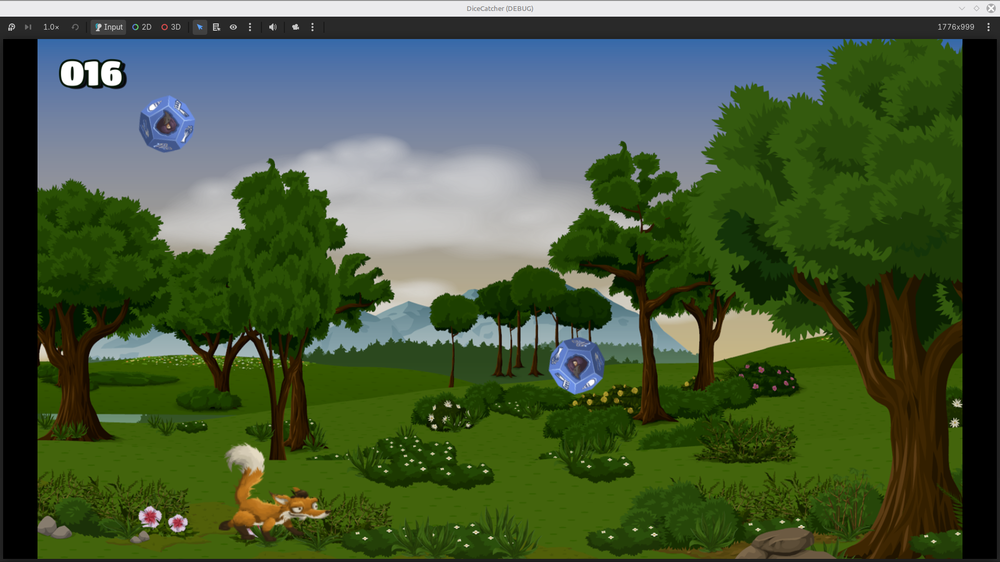
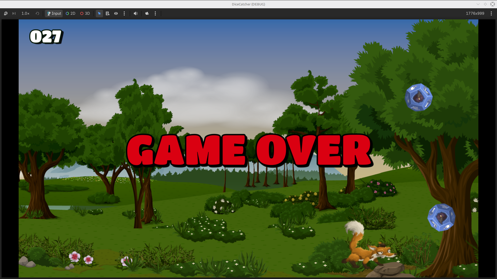

# dice-catcher
A small game made in Godot from the course: "Jumpstart to 2D Game Development: Godot 4 for Beginners". 

# Skills Learned 
- Foundational skills in using the Godot Engine
- Scene instantiation and manipulation
- Communication between different scenes

# Challenge Encountered
- Being unfamiliar with the language
  
# Solution to Challenge
- Taking time to read through the extensive and clear documentation provided.

# In-Game Screenshots

